# ⛪ Hermandad del Mayor Dolor — Aplicación web de gestión

> Aplicación web para que una **hermandad de Semana Santa** publique sus noticias y su calendario de eventos, presente sus grupos (pasos y bandas) y gestione a sus miembros desde un panel privado.

Este documento explica **qué hace la aplicación, cómo está organizada y cómo ponerla en marcha**, con un lenguaje pensado para que lo entienda cualquier persona, sepa o no de programación. Cuando aparece un término técnico, se explica en el momento o en el [glosario](#-glosario) del final.

---

## 📑 Índice

1. [¿Qué es esta aplicación?](#-qué-es-esta-aplicación)
2. [¿Quién la usa? Tipos de usuario](#-quién-la-usa-tipos-de-usuario)
3. [Mapa de la aplicación (todas las páginas)](#-mapa-de-la-aplicación-todas-las-páginas)
4. [Qué puede hacer cada tipo de usuario](#-qué-puede-hacer-cada-tipo-de-usuario)
5. [Recorrido página a página](#-recorrido-página-a-página)
6. [Cómo funciona por dentro (explicado fácil)](#-cómo-funciona-por-dentro-explicado-fácil)
7. [Los datos que maneja la aplicación](#-los-datos-que-maneja-la-aplicación)
8. [Comunicación con el servidor (API)](#-comunicación-con-el-servidor-api)
9. [Seguridad: inicio de sesión y permisos](#-seguridad-inicio-de-sesión-y-permisos)
10. [Piezas reutilizables](#-piezas-reutilizables)
11. [Estructura de carpetas y archivos](#-estructura-de-carpetas-y-archivos)
12. [Tecnologías utilizadas](#-tecnologías-utilizadas)
13. [Instalación y puesta en marcha](#-instalación-y-puesta-en-marcha)
14. [Configuración](#-configuración)
15. [Estado actual, partes sin terminar y puntos a mejorar](#-estado-actual-partes-sin-terminar-y-puntos-a-mejorar)
16. [Glosario](#-glosario)

---

## 🧭 ¿Qué es esta aplicación?

Es la **página web de la Hermandad del Mayor Dolor**. Tiene dos caras:

| Parte | Para quién | Qué ofrece |
|---|---|---|
| 🌐 **Parte pública** | Cualquier visitante, sin necesidad de registrarse | Ver las últimas noticias, leer cada noticia completa y consultar el calendario de eventos. |
| 🔒 **Parte privada** | Miembros de la hermandad que inician sesión | Consultar su perfil, ver los grupos de la hermandad y, según su cargo, administrar usuarios, noticias, grupos y eventos. |

Es importante entender que **esta aplicación es solo la "fachada"** (lo que se ve en el navegador). Los datos reales (usuarios, noticias, eventos, imágenes…) se guardan en **otro programa aparte, el servidor** (también llamado *backend*), que **no está incluido en este repositorio**. Esta aplicación le pide y le envía la información a ese servidor.

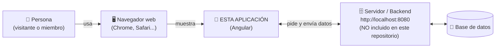

---

## 👥 ¿Quién la usa? Tipos de usuario

La aplicación distingue **cuatro cargos (roles)**, más el visitante anónimo:

| Rol interno | Nombre que se muestra (por ejemplo en el PDF) | ¿Quién es? |
|---|---|---|
| *(sin sesión)* | Visitante | Cualquier persona que entra en la web sin identificarse. |
| `usuario` | **Hermano** | Miembro de base de la hermandad. |
| `capataz` | **Capataz** | Persona que dirige a los costaleros que llevan un paso. |
| `junta` | **Hermano de junta** | Miembro de la junta de gobierno de la hermandad. |
| `admin` | **Administrador** | Responsable técnico con acceso total. |

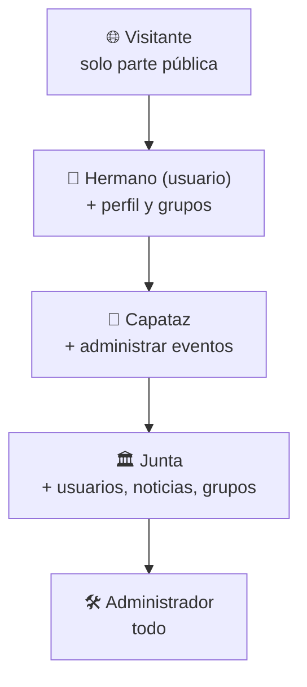

> ℹ️ Cada escalón tiene todo lo del escalón anterior y algo más. La Junta y el Administrador tienen exactamente los mismos permisos dentro de la aplicación; la diferencia es que desde la pantalla de usuarios **no se puede crear ni asignar el rol de Administrador** (solo Hermano, Capataz o Junta).

---

## 🗺️ Mapa de la aplicación (todas las páginas)

Todas las páginas comparten un mismo **marco**: un menú lateral a la izquierda y el contenido a la derecha.

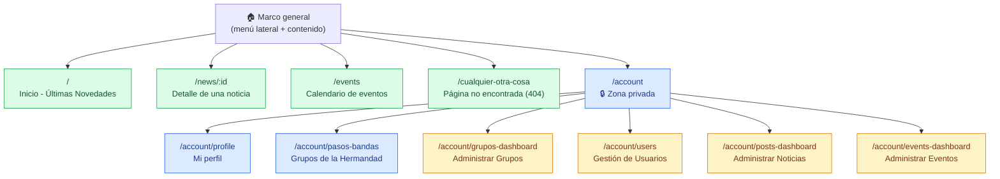

🟩 Pública · 🟦 Requiere iniciar sesión · 🟨 Requiere además un cargo concreto

| Dirección (URL) | Página | ¿Aparece en el menú? | ¿Quién puede entrar? |
|---|---|---|---|
| `/` | Inicio (Últimas Novedades) | ✅ como "Inicio" | Todos |
| `/news/:id` | Detalle de noticia | ❌ (se llega pulsando una noticia) | Todos |
| `/events` | Calendario de eventos | ✅ "Eventos" | Todos |
| `/account/profile` | Mi perfil | ❌ (se llega pulsando tu nombre abajo del menú) | Cualquier usuario con sesión |
| `/account/pasos-bandas` | Grupos de la Hermandad | ✅ | Cualquier usuario con sesión |
| `/account/grupos-dashboard` | Administrar Grupos | ✅ | Admin, Junta |
| `/account/users` | Gestión de Usuarios | ✅ | Admin, Junta |
| `/account/posts-dashboard` | Administrar Noticias | ✅ | Admin, Junta |
| `/account/events-dashboard` | Administrar Eventos | ✅ | Admin, Junta, Capataz |
| cualquier otra | Página no encontrada (404) | ❌ | Todos |

---

## 🔐 Qué puede hacer cada tipo de usuario

| Acción | Visitante | Hermano | Capataz | Junta | Admin |
|---|:-:|:-:|:-:|:-:|:-:|
| Ver y buscar noticias | ✅ | ✅ | ✅ | ✅ | ✅ |
| Leer una noticia completa | ✅ | ✅ | ✅ | ✅ | ✅ |
| Ver el calendario de eventos | ✅ | ✅ | ✅ | ✅ | ✅ |
| Iniciar / cerrar sesión | ✅ (iniciar) | ✅ | ✅ | ✅ | ✅ |
| Ver y editar su propio perfil | ❌ | ✅ | ✅ | ✅ | ✅ |
| Cambiar su contraseña | ❌ | ✅ | ✅ | ✅ | ✅ |
| Ver los grupos de la hermandad | ❌ | ✅ | ✅ | ✅ | ✅ |
| Crear / editar / borrar eventos | ❌ | ❌ | ✅ | ✅ | ✅ |
| Crear / editar / borrar noticias | ❌ | ❌ | ❌ | ✅ | ✅ |
| Crear / editar / borrar grupos | ❌ | ❌ | ❌ | ✅ | ✅ |
| Crear / editar / habilitar / deshabilitar usuarios | ❌ | ❌ | ❌ | ✅ | ✅ |
| Exportar la lista de usuarios a PDF | ❌ | ❌ | ❌ | ✅ | ✅ |

---

## 📄 Recorrido página a página

### 🧱 El marco común (menú lateral)

Es lo que rodea a todas las páginas (`src/app/layout/`).

- **Cabecera** con el logotipo (un icono de costal) y el nombre *"Hermandad del Mayor Dolor"*.
- **Menú de navegación**: se construye solo, leyendo la lista de páginas. Cada persona ve **únicamente las opciones a las que tiene acceso** (ver diagrama más abajo).
- **Pie del menú**:
  - Sin sesión → botón **"Iniciar sesión"**, que abre la ventana de acceso.
  - Con sesión → botón **"Cerrar sesión"** y, debajo, la foto y el **nombre del usuario**, que lleva a "Mi perfil".
- **En móvil y tablet** (pantallas de menos de 1024 px): el menú se esconde y aparece una barra superior con un botón ☰ para desplegarlo. Al pulsar fuera o al elegir una opción, el menú se cierra.
- **Avisos emergentes** (*toasts*): en la esquina superior derecha aparecen mensajes verdes (éxito), rojos (error), amarillos (aviso) o azules (información) que se cierran solos.

¿Cómo decide el menú qué opciones enseñar?

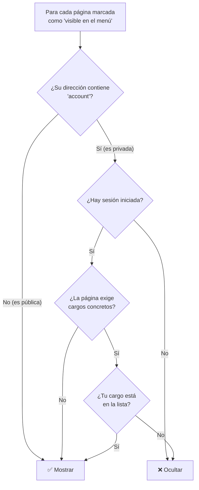

Orden en el que aparecen las opciones: **Inicio · Grupos de la Hermandad · Administrar Grupos · Gestión de Usuarios · Administrar Noticias · Administrar Eventos · Eventos**.

---

### 🔑 Ventana de inicio de sesión

Se abre desde el botón "Iniciar sesión" del menú (`src/app/components/modals/login-modal/`).

| Campo | Reglas |
|---|---|
| Correo electrónico | Obligatorio y con formato de email válido. |
| Contraseña | Obligatoria. |
| Recuérdame | Casilla opcional. Si se marca, la sesión dura **15 días** aunque cierres el navegador. Si no, se pierde al cerrar el navegador. |

- El botón **"Entrar"** está desactivado mientras el formulario no sea válido, y muestra "Cargando..." mientras espera respuesta.
- Si todo va bien aparece *"Bienvenida/o [nombre]"*.
- Si la cuenta está **deshabilitada**, aparece: *"Su cuenta está desactivada. Por favor, contacte con el administrador."*
- Si los datos son incorrectos: *"Credenciales incorrectas. Inténtelo de nuevo."*
- Se puede cerrar pulsando fuera de la ventana.

---

### 🏠 Inicio — "Últimas Novedades" (`/`)

- Muestra la **fecha de hoy** escrita en español (p. ej. *"Lunes, 24 de noviembre de 2026"*).
- Muestra todas las **noticias en tarjetas** (dos columnas en pantallas grandes, una en pantallas pequeñas), cada una con imagen, título, un resumen de 3 líneas y el enlace **"Leer más →"**.
- Tiene un **buscador**: filtra por título o descripción. Empieza a filtrar a partir de **3 letras** y espera un instante (0,15 s) tras dejar de escribir para no ir a trompicones.
- Al pulsar una tarjeta se abre la noticia completa.

### 📰 Detalle de noticia (`/news/:id`)

- Muestra la imagen grande, el título y el texto completo (respetando los saltos de línea).
- Botón **"← Volver a Noticias"** que regresa al inicio.

### 📅 Calendario de eventos (`/events`)

- Calendario **mensual**, con la semana empezando en **lunes** (LUN, MAR, MIE, JUE, VIE, SAB, DOM).
- Flechas para ir al **mes anterior / siguiente**. Cada vez que se cambia de mes se piden al servidor los eventos de ese mes.
- Los eventos aparecen como etiquetas moradas dentro de cada día. Al pulsar uno se abre una **ficha** con: título, fecha (dd/mm/aaaa), grupo que lo **organiza** (si lo tiene) y descripción. Si el evento solo trae el número del grupo y no su nombre, la aplicación lo busca automáticamente.
- Pulsando fuera de la ficha, se cierra.

### 👤 Mi perfil (`/account/profile`)

Dividida en dos tarjetas:

1. **Datos personales**
   - Nombre completo (solo lectura, no se puede cambiar desde aquí).
   - Correo, teléfono y dirección (editables).
   - Botón **"Guardar datos"**: exige que los tres campos estén rellenos.
2. **Cambiar contraseña** (sección plegable con una flecha ▼)
   - Contraseña actual, nueva y confirmación.
   - Comprueba que estén todas rellenas y que la nueva coincida con la confirmación.
   - Si la contraseña actual es incorrecta, el servidor lo indica y se muestra el aviso.

### 🎺 Grupos de la Hermandad (`/account/pasos-bandas`)

- Muestra en **tarjetas** los grupos de la hermandad (pasos, bandas…) con su imagen, nombre y descripción.
- Buscador por nombre o descripción (mínimo 3 letras).
- Es de **solo consulta**: aquí no se edita nada.

### 🛠️ Administrar Grupos (`/account/grupos-dashboard`) — *Admin y Junta*

- Tabla con el **nombre** de cada grupo y botones **Modificar** / **Eliminar**.
- Buscador por nombre.
- Botón **"Añadir Grupo"**, que abre un formulario:

| Campo | Reglas |
|---|---|
| Nombre | Obligatorio, mínimo **6** caracteres. |
| Descripción | Obligatoria, mínimo **10** caracteres. |
| Imagen | Archivo `.jpg`, `.jpeg` o `.png`. **Obligatoria al crear**, opcional al editar (si no se elige, se conserva la anterior). |

### 🗞️ Administrar Noticias (`/account/posts-dashboard`) — *Admin y Junta*

- Igual que la de grupos, pero para noticias: tabla con **título**, botones **Modificar** / **Eliminar**, buscador y botón **"Añadir noticia"**.

| Campo | Reglas |
|---|---|
| Título | Obligatorio, mínimo **6** caracteres. |
| Descripción | Obligatoria, mínimo **10** caracteres. |
| Imagen | `.jpg`, `.jpeg` o `.png`. Obligatoria al crear, opcional al editar. |

### 📆 Administrar Eventos (`/account/events-dashboard`) — *Admin, Junta y Capataz*

- Tabla con el **título** de cada evento, botones **Modificar** / **Eliminar**, buscador y botón **"Añadir Evento"**.
- El formulario de evento pide:

| Campo | Reglas |
|---|---|
| Título del evento | Obligatorio. |
| Fecha | Obligatoria (selector de calendario). |
| Grupo | Opcional. Desplegable con los grupos existentes (se cargan al abrir la ventana). |
| Descripción | Opcional. |

- Tras guardar, la tabla se actualiza sola con los cambios.

### 👥 Gestión de Usuarios (`/account/users`) — *Admin y Junta*

- Tabla con **foto, nombre, email, rol y estado** (Habilitado / Deshabilitado) de cada miembro.
- Buscador por nombre o email.
- Botones superiores:
  - **"Añadir Usuario"**.
  - **"Exportar a PDF"**: descarga `users.pdf` con una tabla de todos los usuarios (nombre, rol, DNI, dirección, teléfono, email y estado) y un pie de página con *"Página X de Y | Total: N usuarios"*.
- En cada fila: **Modificar** y **Deshabilitar** (o **Habilitar** si ya está deshabilitado). En tu propia fila no aparecen botones, para que no puedas deshabilitarte a ti mismo.
- **Importante:** aquí **no se borra** a nadie; se **deshabilita**. Un usuario deshabilitado no puede iniciar sesión, pero sus datos se conservan y se le puede volver a habilitar.

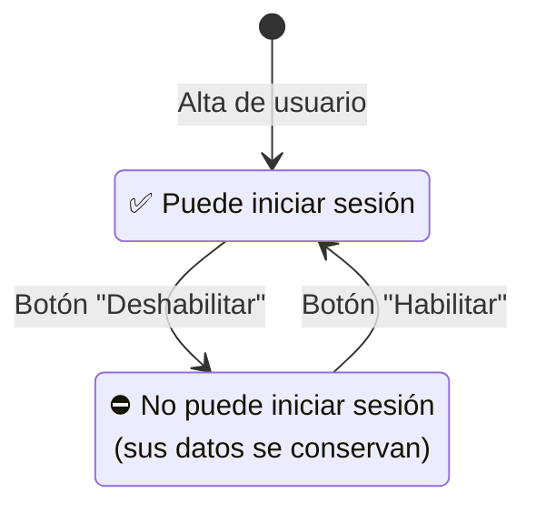

Formulario de usuario (crear o editar):

| Campo | Reglas |
|---|---|
| Nombre y Apellidos | Obligatorio, mínimo 2 caracteres. |
| Teléfono | Obligatorio. 9 cifras que empiecen por 6, 7, 8 o 9 (ej. `600123456`). |
| Email | Obligatorio y con formato válido. |
| DNI | Obligatorio. 7 u 8 números seguidos de una letra válida en mayúscula (ej. `12345678A`). |
| Dirección | Obligatoria. |
| Tipo de Miembro | Usuario, Capataz o Junta. (No se puede elegir Administrador.) |

> El formulario **no pide contraseña** al crear un usuario: se entiende que la asigna el servidor.

### 🚫 Página no encontrada (404)

Si se escribe una dirección que no existe aparece: *"Página no encontrada — La página que buscas se ha perdido en la procesión."* con dos botones: **"Volver a Inicio"** y **"Volver atrás"**.

---

## ⚙️ Cómo funciona por dentro (explicado fácil)

### La idea general

Piensa en la aplicación como en un **restaurante**:

- Las **páginas** son el comedor: lo que ve el cliente.
- Los **servicios** son los camareros: llevan los pedidos a la cocina y traen los platos.
- El **servidor (backend)** es la cocina: es donde de verdad están y se preparan los datos.
- Los **guardias** son el portero: deciden quién puede entrar a cada sala.
- El **interceptor** es el sello en la mano: a cada pedido le pone automáticamente tu "pase" para que la cocina sepa quién eres.

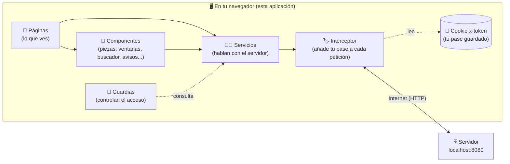

### ¿Qué pasa cuando abres la web?

Antes de enseñar nada, la aplicación comprueba si ya tenías la sesión iniciada de una visita anterior.

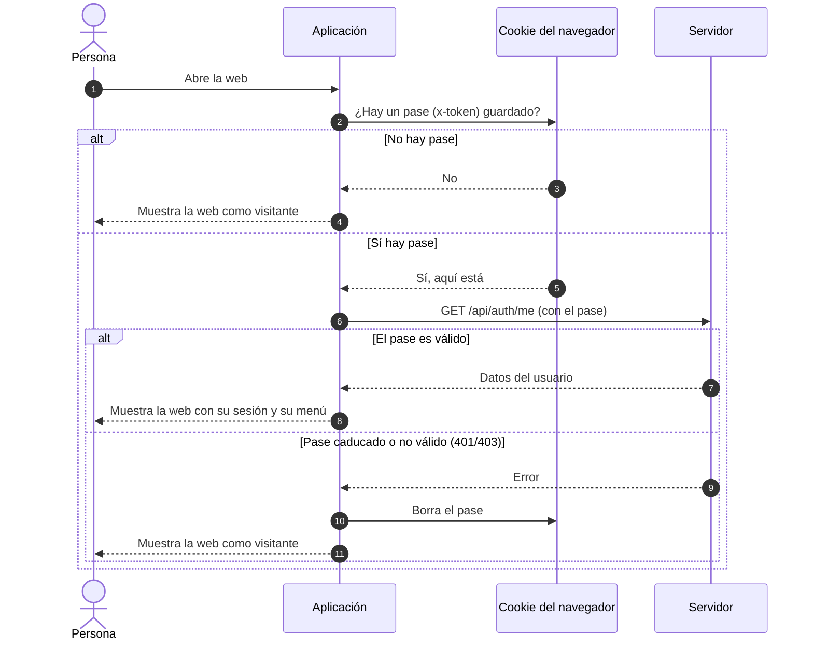

### ¿Qué pasa cuando inicias sesión?

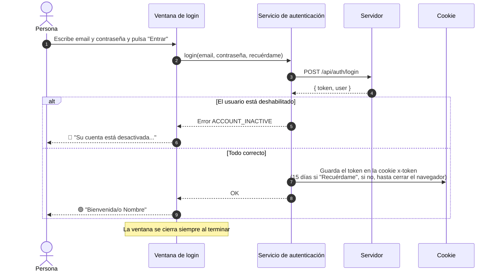

Al **cerrar sesión** se borra la cookie, se olvida al usuario y se vuelve a la página de inicio.

### ¿Qué pasa cuando intentas entrar en una página privada?

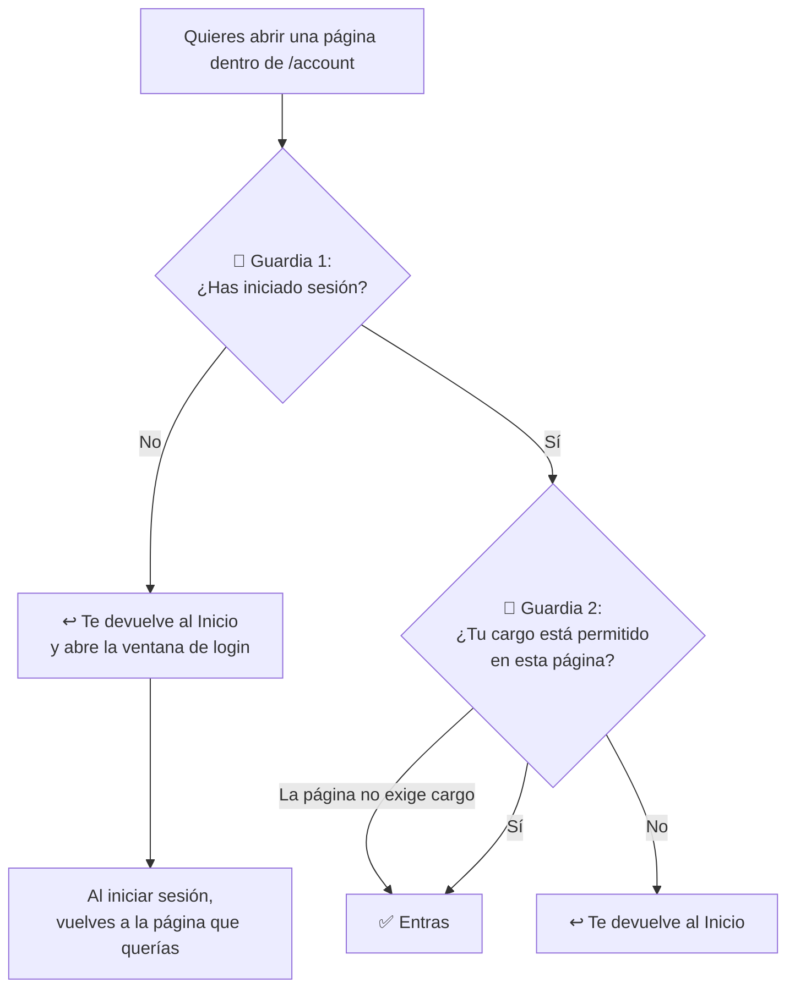

### ¿Qué pasa cuando creas una noticia o un grupo con imagen?

Las imágenes se suben **en dos pasos**: primero la imagen sola, y luego la noticia/grupo "apuntando" a esa imagen.

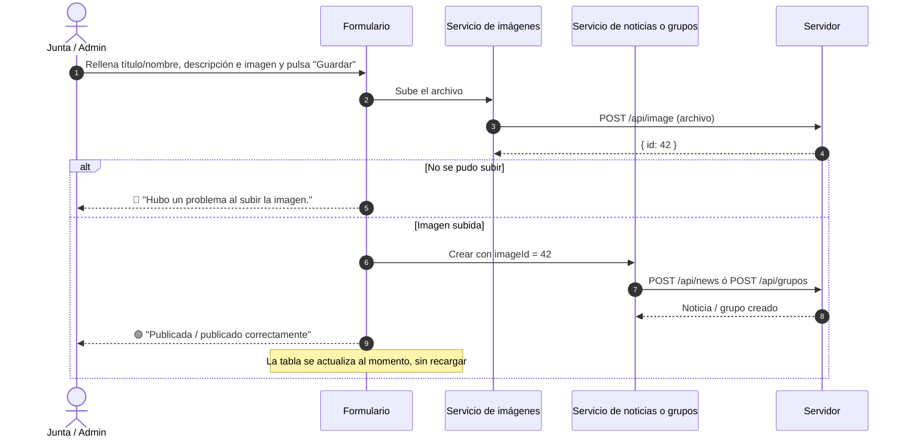

Al **editar**, si no eliges una imagen nueva, se envían solo los textos.

### ¿Cómo se muestran las imágenes?

El servidor solo devuelve la "ruta" de la imagen (por ejemplo `/uploads/foto.png`). Una pequeña pieza (`app-image`) le pega delante la dirección del servidor (`http://localhost:8080`) para que el navegador pueda descargarla.

### Los avisos emergentes (toasts)

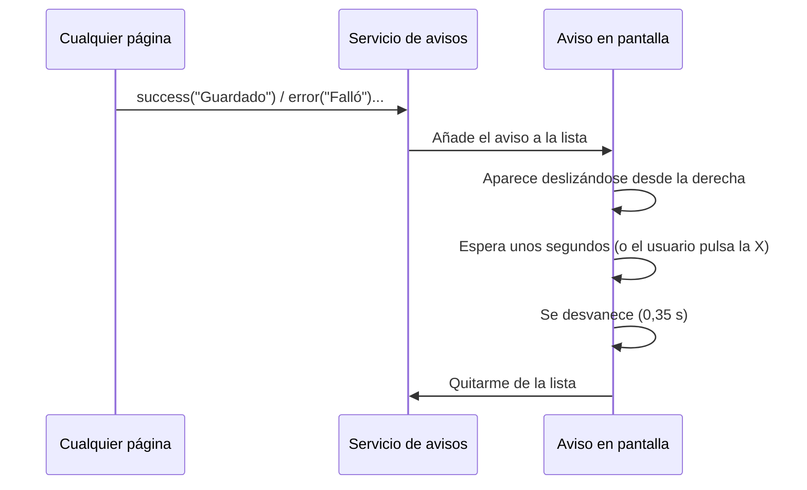

| Tipo | Color | Duración por defecto |
|---|---|---|
| `success` (éxito) | 🟩 Verde | 5 s |
| `error` | 🟥 Rojo | 6 s |
| `warning` (aviso) | 🟨 Amarillo | 5 s |
| `info` (información) | 🟦 Azul | 4 s |

### Los buscadores

Todas las pantallas con listado usan el mismo buscador, que funciona igual en todas:

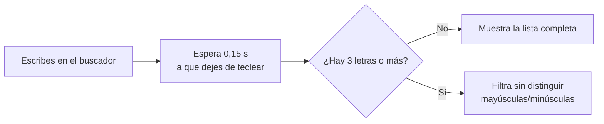

| Pantalla | Busca en… |
|---|---|
| Inicio | Título y descripción de la noticia |
| Grupos de la Hermandad | Nombre y descripción del grupo |
| Administrar Grupos | Nombre del grupo |
| Administrar Noticias | Título |
| Administrar Eventos | Título |
| Gestión de Usuarios | Nombre y email |

> El filtrado se hace en el propio navegador, sobre la lista que ya se descargó; no se vuelve a preguntar al servidor.

---

## 🗃️ Los datos que maneja la aplicación

Hay cinco "fichas" de información principales:

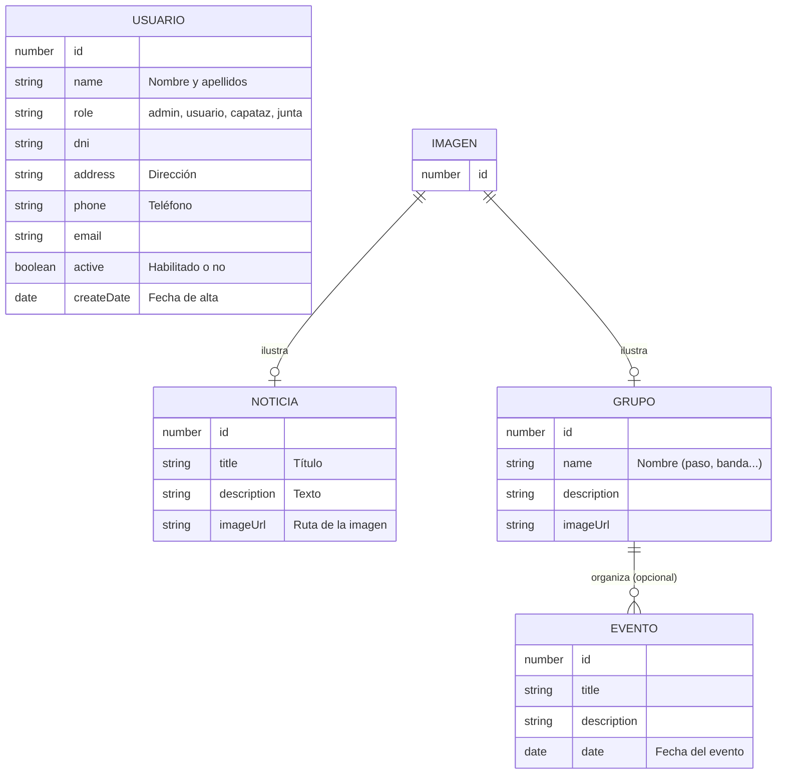

Detalles a tener en cuenta:

- **Evento ↔ Grupo**: un evento puede tener (o no) un grupo organizador. El servidor envía los datos del evento con nombres en español (`fecha`, `grupoId`, `grupoNombre`) y la aplicación los traduce a sus propios nombres (`date`, `group.id`, `group.name`). Al enviar, hace la traducción contraria.
- **Imágenes**: al crear/editar se envía el número de la imagen (`imageId`); al leer, el servidor devuelve la ruta (`imageUrl`).
- Las definiciones exactas están en `src/app/types/`.

---

## 🔌 Comunicación con el servidor (API)

Todas las direcciones empiezan por `http://localhost:8080`. Si hay sesión iniciada, **todas** las peticiones llevan automáticamente la cabecera `Authorization: Bearer <token>`.

### Autenticación

| Método | Dirección | Para qué | Quién lo usa |
|---|---|---|---|
| `POST` | `/api/auth/login` | Iniciar sesión. Envía `{ email, password }`, recibe `{ token, user }`. | Ventana de login |
| `GET` | `/api/auth/me` | Saber quién es el usuario a partir del token. | Arranque de la aplicación |

### Usuarios

| Método | Dirección | Para qué |
|---|---|---|
| `GET` | `/api/usuario/all` | Listar todos los usuarios |
| `GET` | `/api/usuario/{id}` | Ver un usuario *(definido, no se usa todavía)* |
| `POST` | `/api/usuario` | Crear un usuario |
| `PUT` | `/api/usuario/{id}` | Modificar un usuario (también para habilitar/deshabilitar) |
| `DELETE` | `/api/usuario/{id}` | Borrar un usuario *(definido, no se usa: se deshabilita en su lugar)* |
| `PUT` | `/api/usuario/me` | Actualizar mi perfil `{ email, phone, address }` |
| `PUT` | `/api/usuario/me/password` | Cambiar mi contraseña `{ oldPassword, newPassword, confirmPassword }` |

### Noticias

| Método | Dirección | Para qué |
|---|---|---|
| `GET` | `/api/news/all` | Listar todas las noticias |
| `GET` | `/api/news/{id}` | Ver una noticia |
| `POST` | `/api/news` | Crear `{ title, description, imageId }` |
| `PUT` | `/api/news/{id}` | Modificar `{ id, title, description, imageId }` |
| `DELETE` | `/api/news/{id}` | Borrar |

### Grupos

| Método | Dirección | Para qué |
|---|---|---|
| `GET` | `/api/grupos` | Listar todos los grupos |
| `GET` | `/api/grupos/{id}` | Ver un grupo |
| `POST` | `/api/grupos` | Crear `{ name, description, imageId }` |
| `PUT` | `/api/grupos/{id}` | Modificar `{ id, name, description, imageId? }` |
| `DELETE` | `/api/grupos/{id}` | Borrar |

### Eventos

| Método | Dirección | Para qué |
|---|---|---|
| `GET` | `/api/events/month?year=AAAA&month=MM` | Eventos de un mes (calendario público) |
| `GET` | `/api/events/all` | Todos los eventos (panel de administración) |
| `POST` | `/api/events` | Crear `{ title, description, fecha: "AAAA-MM-DD", grupoId? }` |
| `PUT` | `/api/events/{id}` | Modificar (mismo formato) |
| `DELETE` | `/api/events/{id}` | Borrar |

### Imágenes

| Método | Dirección | Para qué |
|---|---|---|
| `POST` | `/api/image` | Subir una imagen (formulario con el campo `image`). Devuelve `{ id }`. |

---

## 🛡️ Seguridad: inicio de sesión y permisos

| Pieza | Archivo | Qué hace |
|---|---|---|
| **Cookie de sesión** | `src/app/constants/cookies.ts` | El "pase" se guarda en una cookie llamada `x-token`, válida para toda la web (`/`). |
| **Interceptor** | `src/app/interceptors/auth.interceptor.ts` | Añade el pase a todas las peticiones al servidor. |
| **Guardia "¿has iniciado sesión?"** | `src/app/guards/is-user-logged.ts` | Si no hay sesión, te manda al inicio añadiendo `?returnUrl=/la/pagina/deseada`. El menú abre entonces la ventana de login y, al entrar, te lleva a esa página. |
| **Guardia "¿tienes el cargo?"** | `src/app/guards/is-user-allowed-by-role.ts` | Si tu cargo no está en la lista permitida de la página, te manda al inicio. |
| **Servicio de autenticación** | `src/app/services/auth.service.ts` | Inicia y cierra sesión, recuerda quién eres y recupera la sesión al abrir la web. |
| **Lista de cargos** | `src/app/constants/user-role.ts` | `admin`, `usuario`, `capataz`, `junta`. |

> ⚠️ **Recordatorio importante**: estas comprobaciones solo esconden pantallas en el navegador. La **seguridad real** (que nadie pueda, por ejemplo, borrar una noticia sin permiso) **debe hacerla el servidor**, que es quien de verdad guarda los datos.

---

## 🧩 Piezas reutilizables

### Componentes compartidos (`src/app/components/`)

| Pieza | Etiqueta | Para qué sirve |
|---|---|---|
| Buscador | `app-search-box` | Caja de búsqueda con lupa. Avisa de cada tecla (`onInput`) y de cuando se pulsa Intro (`onEnter`, que además vacía la caja). |
| Imagen | `app-image` | Muestra una imagen que viene del servidor, completando su dirección. |
| Aviso | `app-toast` | Cada uno de los mensajes emergentes. |
| Ventana de login | `app-login-modal` | Formulario de inicio de sesión. |
| Ventana de usuario | `app-user-modal` | Crear / editar un usuario. |
| Ventana de evento | `app-event-modal` | Crear / editar un evento. |
| Ventana de registro | `app-register-modal` | Diseño de un formulario de alta. **No está conectada** (ver más abajo). |
| Ventana de paso/banda | `app-paso-banda-modal` | Diseño de un editor de pasos/bandas. **No se usa** en ninguna página. |

Las ventanas de **noticia** (`app-post-modal`) y **grupo** (`app-grupo-modal`) están junto a sus páginas de administración.

### Servicios (`src/app/services/`)

| Servicio | Responsabilidad |
|---|---|
| `AuthService` | Sesión del usuario (login, logout, recuperar sesión, consultar rol). |
| `UsersService` | Usuarios y perfil propio. |
| `PostsService` | Noticias. |
| `GrupoService` | Grupos. |
| `EventsService` | Eventos (y traducción de nombres de campos español ↔ inglés). |
| `ImagesService` | Subida de imágenes. |
| `PdfService` | Genera el PDF de usuarios (A4 vertical, cabecera azul, filas alternas en azul claro, traduce los roles a "Administrador", "Hermano", "Hermano de junta", "Capataz"). |
| `ToastService` | Lista de avisos emergentes. |

### Iconos (`src/app/components/icons/`)

Pequeños dibujos en formato SVG, cada uno en su archivo. Aceptan una propiedad `className` para cambiar tamaño o girarlos.

| Icono | Dónde se usa |
|---|---|
| `add-user` | Botón "Añadir Usuario" |
| `arrow` | "Leer más", "Volver a Noticias" |
| `calendar` | Menú: Eventos y Administrar Eventos |
| `chevron` | Flechas del calendario y del desplegable de rol |
| `costal` | Logotipo del menú |
| `folders` | Menú: Administrar Noticias, y botones "Añadir" |
| `glass` | Lupa del buscador |
| `grid` | Menú: Inicio |
| `login` / `logout` | Botones de iniciar y cerrar sesión |
| `music` | Menú: Grupos |
| `save` | "Guardar datos" y "Exportar a PDF" |
| `users` | Menú: Gestión de Usuarios |
| `x` | Botón de cerrar ventanas y avisos |
| `clock`, `edit`, `gear`, `plus`, `random`, `trash` | Disponibles pero **sin usar** actualmente |

---

## 📁 Estructura de carpetas y archivos

```text
GestionUser-Angular/
├── public/                         ← Archivos que se sirven tal cual
│   ├── favicon.ico                 ← Icono de la pestaña del navegador
│   └── images/avatar.png           ← Foto de perfil genérica (la misma para todos)
│
├── src/
│   ├── index.html                  ← Página base; carga la fuente "Inter" de Google Fonts
│   ├── main.ts                     ← Punto de arranque de la aplicación
│   ├── styles.css                  ← Estilos globales + Tailwind
│   ├── environments/               ← Configuración (dirección del servidor)
│   │   ├── environment.ts              (producción)
│   │   └── environment.development.ts  (desarrollo)
│   │
│   └── app/
│       ├── app.ts / app.html / app.css  ← Componente raíz (solo contiene las páginas)
│       ├── app.config.ts           ← Configuración global (rutas, interceptor, cookies, carga de sesión)
│       ├── app.routes.ts           ← Lista de páginas, permisos e iconos del menú
│       │
│       ├── layout/                 ← Marco común: menú lateral, login y avisos
│       ├── pages/
│       │   ├── public/             ← Páginas públicas
│       │   │   ├── home/               Inicio (noticias)
│       │   │   ├── news-detail/        Detalle de noticia
│       │   │   ├── events/             Calendario
│       │   │   └── not-found/          Error 404
│       │   └── private/            ← Páginas privadas
│       │       ├── profile/            Mi perfil
│       │       ├── pasos-bandas/       Grupos de la Hermandad (consulta)
│       │       ├── grupos-dashboard/   Administrar Grupos (+ ventana de grupo)
│       │       ├── posts-dashboard/    Administrar Noticias (+ ventana de noticia)
│       │       ├── events-dashboard/   Administrar Eventos
│       │       ├── users/              Gestión de Usuarios
│       │       └── sections/           Gestión de Costaleros (prototipo, NO activo)
│       │
│       ├── components/             ← Piezas reutilizables (buscador, imagen, avisos, ventanas, iconos)
│       ├── services/               ← "Camareros" que hablan con el servidor
│       ├── guards/                 ← "Porteros" de las páginas privadas
│       ├── interceptors/           ← Añade el pase a cada petición
│       ├── constants/              ← Valores fijos (roles, nombre de la cookie)
│       └── types/                  ← Forma de los datos (Usuario, Noticia, Grupo, Evento)
│
├── angular.json                    ← Configuración de construcción de Angular
├── package.json                    ← Dependencias y comandos
├── package-lock.json               ← Versiones exactas instaladas
├── tsconfig*.json                  ← Configuración de TypeScript
├── .postcssrc.json                 ← Activa Tailwind CSS
├── .editorconfig                   ← Estilo de código (2 espacios, UTF-8, comillas simples)
├── .vscode/                        ← Ajustes recomendados para Visual Studio Code
└── .gitignore                      ← Archivos que no se suben a Git
```

### Cómo se relacionan las piezas

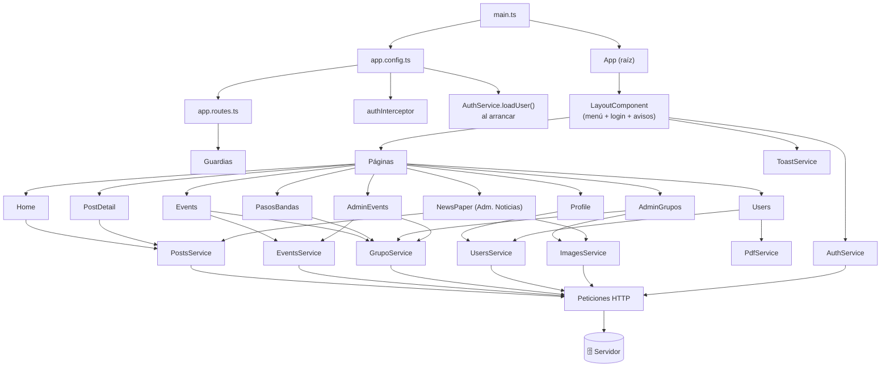

---

## 🧰 Tecnologías utilizadas

| Tecnología | Versión | Para qué se usa (en palabras sencillas) |
|---|---|---|
| [Angular](https://angular.dev) | 21 | El "esqueleto" de la aplicación: páginas, navegación, formularios. Usa componentes independientes (*standalone*) y **señales** (*signals*) para que la pantalla se actualice sola cuando cambian los datos. |
| [TypeScript](https://www.typescriptlang.org) | 5.9 | El lenguaje de programación (JavaScript con comprobación de tipos para evitar errores). |
| [Tailwind CSS](https://tailwindcss.com) | 4 | Para dar estilo (colores, tamaños, espacios) directamente desde el HTML. Se combina con algunos archivos `.css` propios. |
| [RxJS](https://rxjs.dev) | 7.8 | Gestiona las respuestas del servidor, que llegan "más tarde". |
| [ngx-cookie-service](https://www.npmjs.com/package/ngx-cookie-service) | 21 | Guardar y leer la cookie de sesión. |
| [jsPDF](https://github.com/parallax/jsPDF) + [jspdf-autotable](https://github.com/simonbengtsson/jsPDF-AutoTable) | 4 / 5 | Crear el PDF de la lista de usuarios directamente en el navegador. |
| [Vitest](https://vitest.dev) + jsdom | 4 / 27 | Herramienta de pruebas automáticas (configurada, pero todavía sin pruebas escritas). |
| Fuente **Inter** | — | Tipografía de toda la web, cargada desde Google Fonts. |
| npm | 10.9.4 | Gestor de paquetes. |

---

## 🚀 Instalación y puesta en marcha

### 1. Requisitos previos

- **Node.js** (versión 20 o superior; recomendado la versión LTS más reciente) → <https://nodejs.org>
- **npm** (viene con Node.js).
- El **servidor (backend)** de la hermandad funcionando en `http://localhost:8080`. Sin él, la web se abrirá pero **no mostrará datos** ni permitirá iniciar sesión.

### 2. Descargar e instalar

```bash
git clone https://github.com/RafaNietoCampos/GestionUser-Angular.git
cd GestionUser-Angular
npm install
```

### 3. Arrancar en modo desarrollo

```bash
npm start
```

Abre el navegador en **<http://localhost:4200>**. Cada vez que se guarda un cambio en el código, la página se recarga sola.

### 4. Todos los comandos disponibles

| Comando | Qué hace |
|---|---|
| `npm start` | Arranca la web en `http://localhost:4200` (modo desarrollo). |
| `npm run build` | Prepara la versión final optimizada en la carpeta `dist/`. |
| `npm run watch` | Como `build`, pero se repite automáticamente con cada cambio (modo desarrollo). |
| `npm test` | Ejecuta las pruebas automáticas con Vitest. |
| `npm run ng -- <comando>` | Acceso directo a la herramienta de Angular (por ejemplo, `npm run ng -- generate component nombre`). |

### 5. Desde Visual Studio Code

El proyecto incluye configuración en `.vscode/`:

- Recomienda instalar la extensión **Angular Language Service**.
- Formatea y ordena las importaciones al guardar.
- Desde el panel "Ejecutar y depurar" se puede lanzar **"ng serve"** (abre Chrome en `localhost:4200`) o **"ng test"**.

### Límites de tamaño en la versión final

Al hacer `npm run build`, Angular avisa si:

- La carga inicial supera **500 kB** (aviso) o **1 MB** (error).
- El estilo de un componente supera **4 kB** (aviso) u **8 kB** (error).

---

## 🔧 Configuración

### Dirección del servidor

Se define en `src/environments/`:

```ts
// environment.development.ts  (desarrollo)
export const environment = { production: false, apiUrl: 'http://localhost:8080' };

// environment.ts  (versión final)
export const environment = { production: true, apiUrl: 'http://localhost:8080' };
```

Para publicar la web apuntando a un servidor real, basta con cambiar `apiUrl` en `environment.ts`. Toda la aplicación lee `environment.ts`; al arrancar en modo desarrollo, Angular lo sustituye automáticamente por `environment.development.ts`.

### Atajo de importaciones

En `tsconfig.app.json` se define `@app/*` como atajo de `src/app/*`, de modo que en el código se escribe `@app/services/auth.service` en lugar de rutas largas con `../../`.

### Estilo del código

- 2 espacios de sangría, UTF-8, comillas simples (`.editorconfig`).
- Prettier: líneas de hasta 100 caracteres y comillas simples (`package.json`).
- TypeScript en modo **estricto**.

---

## 🚧 Estado actual, partes sin terminar y puntos a mejorar

Para que no se escape ningún detalle, aquí está todo lo que se ha detectado al revisar el código.

### Partes sin terminar o desactivadas

| Elemento | Situación |
|---|---|
| **Gestión de Costaleros** (`pages/private/sections`) | Prototipo con datos de ejemplo inventados (15 personas ficticias). Permite pasar personas de "Disponibles" a "Asignados" a un paso (Paso Cristo / Paso Virgen), pero el botón "Guardar" no hace nada. La página está **desactivada** en `app.routes.ts` con el comentario *"¿Próximamente?"*. |
| **Ventana de registro** (`register-modal`) | Solo es el diseño: los campos no están conectados y el botón "Registrar Usuario" no hace nada. Además no aparece en ninguna pantalla. |
| **Ventana de paso/banda** (`paso-banda-modal`) | Diseño de un editor que no se usa en ninguna página. |
| **"¿Olvidaste tu contraseña?"** | Enlace preparado pero comentado en la ventana de login. |
| **Crear eventos desde el calendario público** | Existe el código para un botón "nuevo evento" en `/events`, pero el botón no aparece en la pantalla. Los eventos se crean desde "Administrar Eventos". |
| **Pruebas automáticas** | Vitest está configurado, pero no hay ningún archivo de pruebas. |
| **Foto de perfil** | Todos los usuarios muestran la misma imagen (`avatar.png`). |

### Fallos corregidos (24/11/2026)

| Fallo | Solución |
|---|---|
| Los eventos aparecían en días equivocados del calendario (se usaba el día de la semana en vez del día del mes). | Se usa `getDate()` en `events.html`. |
| En tablets (768–1024 px) no había forma de abrir el menú. | La barra superior con el botón ☰ se muestra hasta los 1024 px. |
| Algunos archivos leían siempre la configuración de desarrollo. | Todos importan `environments/environment`. |
| Guardar un evento recargaba toda la web. | Se recarga solo la tabla de eventos. |
| El perfil no se refrescaba tras guardarlo y los errores salían en un `alert()`. | Se actualizan los datos de la sesión y los errores se muestran con un aviso. |
| Editar una noticia sin cambiar la imagen enviaba `imageId: null`. | Ya no se envía `imageId` si no hay imagen nueva (igual que en grupos), y se cancela si falla la subida. |
| El icono `gear` usaba la misma etiqueta que `grid`. | Ahora es `app-gear-icon`. |
| El `returnUrl` no se usaba. | Se guarda la ruta completa, se abre el login automáticamente y, tras entrar, se vuelve a esa página. |
| Erratas: "Administar", título "ProyectoAngular" e idioma inglés. | Corregido a "Administrar", título "Hermandad del Mayor Dolor" e idioma `es`. |
| Los avisos usaban la hora como identificador. | Usan un contador que no se repite. |

### Pendiente

- Al construir la versión final, Angular avisa de que la carga inicial (≈ 922 kB) supera el límite recomendado de 500 kB. Es solo un aviso y se debe sobre todo a la librería de PDF; se podría reducir cargándola únicamente al pulsar "Exportar a PDF".

---

## 📖 Glosario

| Término | Significado |
|---|---|
| **Hermandad** | Asociación religiosa que organiza, entre otras cosas, las procesiones de Semana Santa. |
| **Paso** | Plataforma con imágenes religiosas que se saca en procesión. |
| **Banda** | Grupo musical que acompaña a un paso. |
| **Costalero** | Persona que carga el paso sobre su cuello/hombros (el icono del logo es un costal). |
| **Capataz** | Quien dirige y da las órdenes a los costaleros. |
| **Junta (de gobierno)** | Órgano directivo de la hermandad. |
| **Frontend** | La parte de una aplicación que se ve y se usa en el navegador (este repositorio). |
| **Backend / servidor** | Programa que guarda y gestiona los datos; esta web habla con él. No está en este repositorio. |
| **API** | Conjunto de "direcciones" del servidor a las que se pueden pedir o enviar datos. |
| **GET / POST / PUT / DELETE** | Tipos de petición: leer, crear, modificar y borrar, respectivamente. |
| **Token** | Código secreto que el servidor entrega al iniciar sesión y que demuestra quién eres. |
| **Cookie** | Pequeño dato que el navegador guarda; aquí se usa para recordar el token. |
| **Ruta / URL** | La dirección que aparece en la barra del navegador (`/events`, `/account/users`…). |
| **Guardia (guard)** | Comprobación que decide si puedes entrar en una página. |
| **Interceptor** | Pieza que modifica automáticamente todas las peticiones antes de enviarlas. |
| **Componente** | Pieza visual reutilizable (un botón, una ventana, una página…). |
| **Servicio** | Pieza sin parte visual que hace un trabajo concreto (hablar con el servidor, generar un PDF…). |
| **Modal / ventana emergente** | Ventana que aparece por encima de la página, oscureciendo el fondo. |
| **Toast** | Aviso pequeño y temporal que aparece en una esquina. |
| **Señal (signal)** | Forma que tiene Angular de guardar un dato y actualizar la pantalla automáticamente cuando cambia. |
| **Debounce** | Esperar un momento a que el usuario deje de escribir antes de reaccionar. |
| **Rol** | El cargo de un usuario, que determina qué puede hacer. |
| **Deshabilitar** | Impedir que un usuario inicie sesión sin borrar sus datos. |

---

<p align="center">Hecho con ❤️ para la <strong>Hermandad del Mayor Dolor</strong></p>
